  <picture>
    <source media="(max-width: 900px)" srcset="./assets/hero-still-mobile.svg">
    
  </picture>

  
  
  

## About

<picture></picture>

I'm a software developer in Kolkata, India. I build Linux desktop tools and use scripting, system services and local AI tooling to automate day-to-day work. Manual QA and workflow testing are part of how I build and troubleshoot software.

I completed a diploma in **automobile engineering**. My creative work includes photo and video editing, marketing automation and 3D CAD in SolidWorks.

## Technology stack

<picture></picture>

  <picture>
    <source media="(max-width: 1000px)" srcset="./assets/stack-mobile.svg">
    
  </picture>

## Selected projects

<picture></picture>

  <a href="https://ethnicbnb.com/"><picture><source media="(max-width: 600px)" srcset="./assets/live-ethnicbnb-mobile.svg"></picture></a>
  <a href="https://puremilk.co.in/"><picture><source media="(max-width: 600px)" srcset="./assets/live-puremilk-mobile.svg"></picture></a>

### Open-source work

<picture></picture>

- **[Wall Blazer](https://github.com/oooosonuoooo/Wall-Blazer)** runs video playlists, streams and web pages as live wallpapers on Linux.
- **[Kali Splash Pro](https://github.com/oooosonuoooo/Kali-Splash-Pro)** manages the boot splash screen on Kali Linux XFCE with systemd.
- **[Friday Local LLM](https://github.com/oooosonuoooo/friday-local-llm)** documents how to configure and run a local AI assistant.

<picture></picture>

<em>Understand, build, test, automate, repeat.</em>

